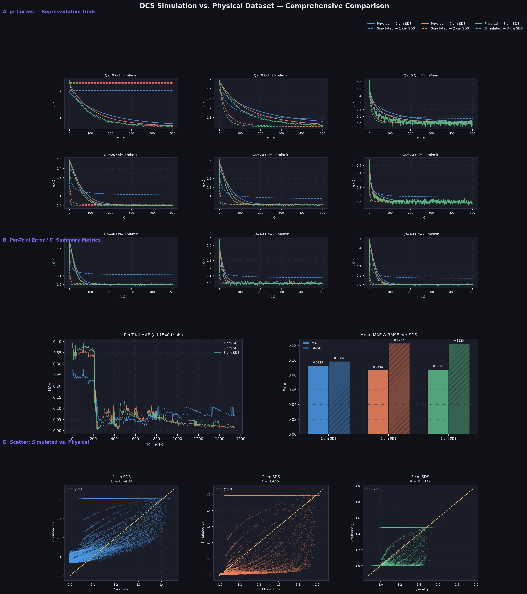

# Comparison Report — Simulated vs. Physical DCS Dataset

> Generated from `plot_comparison.py` using `Dataset_phantom-intra40.mat` (physical) and `Dataset_simulated-intra40.mat` (simulated).

---

## Comparison Plot



---

## Error Summary

| SDS Channel | MAE    | RMSE   |
|-------------|--------|--------|
| 1 cm SDS    | 0.09253 | 0.09836 |
| 2 cm SDS    | 0.08682 | 0.12274 |
| 3 cm SDS    | 0.08748 | 0.12227 |

- **MAE** (Mean Absolute Error) — average point-by-point difference across all 1540 trials × 501 delay times
- **RMSE** (Root Mean Squared Error) — penalises large deviations more than MAE

---

## Panel-by-Panel Walkthrough

### Panel A — g₂ Curves (3×3 grid)
- **What:** Overlays physical (solid line) and simulated (dashed line) g₂(τ) curves for 9 representative flow combinations: shallow flow Qs ∈ {0, 20, 40} × deep flow Qd ∈ {0, 20, 40} ml/min.
- **3 colours** = 3 source-detector separations (1 cm blue · 2 cm orange · 3 cm green).
- **Observation:** Curve shapes generally agree. The main mismatch appears at the 1 cm SDS (blue), where the simulated curve sits slightly higher, especially at zero-flow conditions — consistent with the β calibration offset.

### Panel B — Per-Trial MAE (line plot)
- **What:** MAE for each of the 1540 individual trials, ordered by trial index.
- **Observation:** Error is higher in the first ~400 trials (high-flow region) and drops as flow decreases. The 1 cm SDS shows more variance — shorter SDS is more sensitive to shallow-layer dynamics which are harder to calibrate precisely.

### Panel C — Mean MAE & RMSE Bar Chart
- **What:** Global average error across all trials per SDS.
- **Observation:** All three channels are in the same order of magnitude (~0.087–0.093 MAE). RMSE is noticeably larger for 2 cm and 3 cm SDS, indicating occasional large-deviation outlier trials at longer separations.

### Panel D — Scatter: Simulated vs. Physical g₂
- **What:** 20 000 randomly sampled g₂ data points per SDS. The dashed gold line is y = x (perfect agreement).
- **R values:** 1 cm = 0.64 · 2 cm = 0.46 · 3 cm = 0.39
- **Observation:** The simulated g₂ at 1 cm SDS clusters near a constant value at high τ (the β floor), while the physical data continues to decay — suggesting residual β over-estimation at long delay times for the closest detector.

---

## Step-by-Step: How This Comparison Was Produced

```
Step 1 — simulation.py
  Run 100M-photon MCX simulation on GPU
  → pathlengths.npz  (partial pathlengths Ls, Ld per detector)

Step 2 — generate_dataset.py
  Load preset flow rates from physical MAT file
  Fit β per SDS from physical data at tau=0
  Compute g2(tau) for all 1540 trials using calibrated D_B scaling
  → Dataset_simulated-intra40.mat

Step 3 — plot_comparison.py
  Load both MAT files
  Compute MAE & RMSE per trial per SDS
  Plot Panel A : g2 curve overlays (9 representative combos)
  Plot Panel B : per-trial MAE line chart
  Plot Panel C : summary MAE/RMSE bar chart
  Plot Panel D : scatter simulated vs. physical with R coefficient
  → plots/full_comparison.png
```

---

## Quick Run

```powershell
# Activate environment
.\venv_mcx\Scripts\Activate.ps1

# Re-generate plot at any time
python .\code\plot_comparison.py `
  --physical  .\data\Dataset_phantom-intra40.mat `
  --simulated .\data\Dataset_simulated-intra40.mat `
  --output    .\plots\full_comparison.png
```
